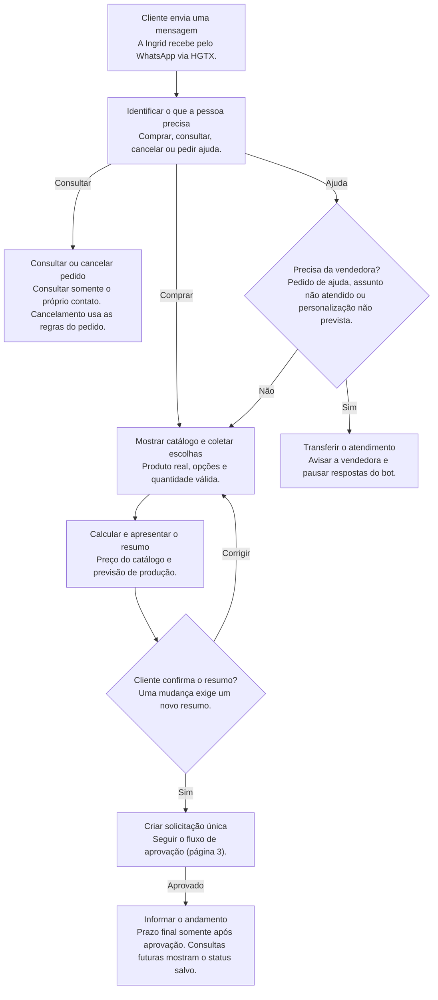
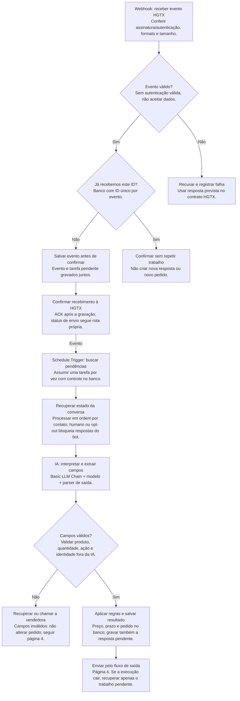
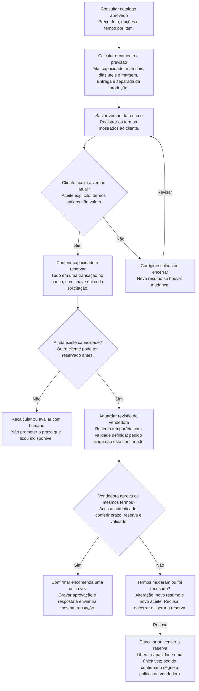
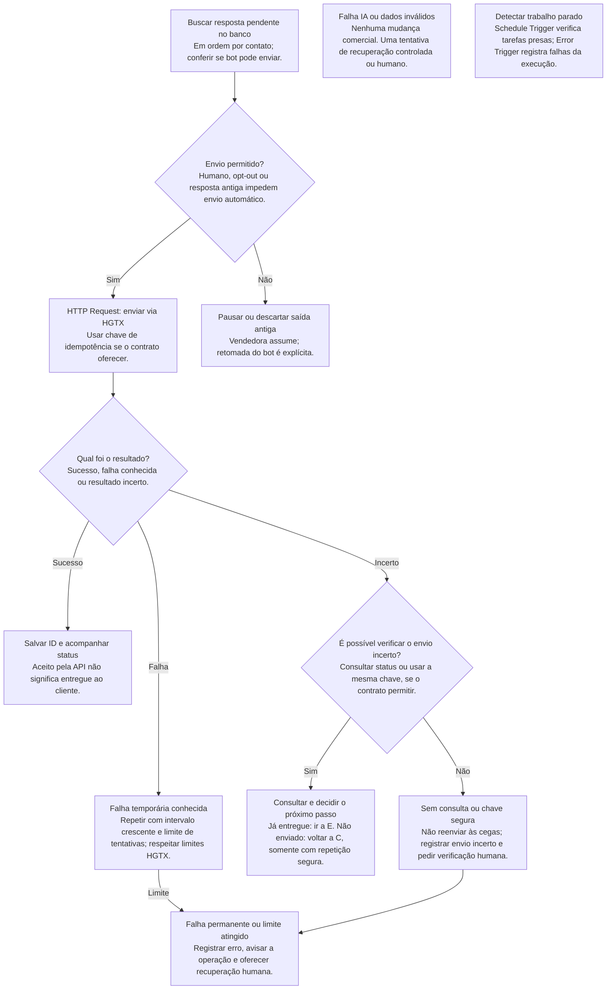

# Ingrid: fluxogramas do atendimento e automação

Bruno Proença Silva | Revisão de 06/10/2026. Desenhos para revisão da equipe; a automação ainda será implementada. Sistema pronto: 03/11/2026.

Como ler: retângulos são etapas; caixas rosas com pergunta são decisões; setas indicam o próximo passo. O PDF usa a mesma sequência deste arquivo.

Prazos internos: S03, S04, S05 e S06 até 08/10; S08 e S11 iniciam em 09/10. O envio oficial do Sprint 3 continua em 06/10.

Vocabulário: webhook = entrada de eventos; ACK = confirmação de recebimento; parser = leitor do formato de saída; transação = gravação que acontece por inteiro ou não acontece; idempotência = repetir sem duplicar o efeito; opt-out = pedido para parar mensagens.

## 01 - Atendimento no WhatsApp

Maria Clara revisa a jornada; Matheus confere mensagens e limites.

Sem descontos ou condições não aprovadas. Opt-out (pedido para parar mensagens) interrompe os envios automáticos; mensagens de erro oferecem uma alternativa clara.

## 02 - Recepção e processamento no n8n

Rafael revisa os nós e o banco; Matheus testa repetição, reinício e dois clientes.

Evento de status atualiza a entrega, sem chamar a IA. Banco indisponível: não dar ACK de sucesso; permitir reentrega conforme contrato. Saída inválida da IA: não alterar pedido; recuperação limitada ou atendimento humano (página 4).

## 03 - Encomenda, capacidade e aprovação

Rafael monta o cálculo; Bruno valida as regras com a vendedora.

A reserva e a aprovação revalidam dados no banco; chamadas separadas não podem vender a mesma capacidade. Alteração de preço, prazo ou opções invalida o aceite anterior. Expiração e rejeição liberam apenas reservas ativas.

## 04 - Envio, falhas e atendimento humano

Rafael implementa a recuperação; Matheus registra o esperado e o observado.

Envio confirmado: salvar resultado. Nova tentativa segura volta ao envio (C). Falhas de execução são registradas sem apagar encomendas; logs e capturas omitem dados pessoais e segredos. O contrato HGTX ainda precisa confirmar IDs, status e idempotência.
